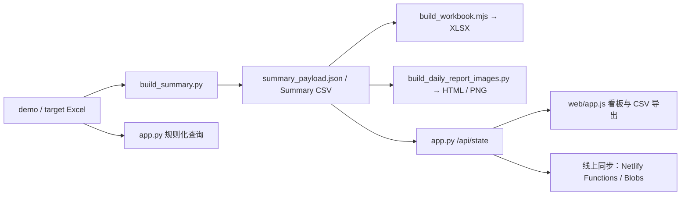

# 当前架构与数据流

本文是现行代码的导航图。需求和详细计算口径分别见 [PRD](./PRD-progress-dashboard.md) 与 [业务规则](./business-rules.md)；历史选择见 [decisions/](../decisions/INDEX.md)。

## 总览

本地 Excel 是输入，`outputs/tongji_summary/build_summary.py` 负责必要列与日期校验、维度聚合、渠道归属、指标计算和 `summary_payload.json`；本地服务 `app.py` 负责重算、状态接口、查询、图片下载、同步及钉钉播报。页面与工作簿消费 Summary 产物。播报图以 Summary CSV 为主输入，LEC 专项图还读取原始 demo/target 以分配渠道。

## 核心功能与文件

| 功能 | 实现与数据去向 |
| --- | --- |
| 统一 Summary | `outputs/tongji_summary/build_summary.py` 读取两个固定工作表，生成 `tongji_summary_current.csv`、`summary_payload.json`、`metadata.csv`、维度分布 CSV；payload 含 `summary`、`latest_summary`、`detail_latest_summary`、`daily_summary`、`latest_daily_summary` 和 `metrics`。 |
| 工作簿 | `outputs/tongji_summary/build_workbook.mjs` 读取 payload，写 `tongji_summary_current.xlsx` 的“目标现状对比”“数据概览”“计算规则”工作表；计算规则页是文字说明，不是第二套公式。 |
| 播报图 | `reports/build_daily_report_images.py` 读取 Summary CSV，生成总进度、四学部及 LEC 专项 HTML 和 `manifest.json`；`reports/export_daily_report_images.mjs` 将 HTML 导出 PNG。渠道、年级聚合及展示用状态/GAP 在播报层生成。 |
| 本地 API | `app.py` 的 `rebuild_outputs` 串联 Summary、工作簿和图片；`GET /api/state` 输出统一状态，`GET /api/health` 给出进程信息；`POST /api/reload-demo`、`/api/reload-target` 和 `/api/upload` 触发重算；`/download/summary`、`/download/workbook`、`/download/report` 提供下载。 |
| 看板 | `web/index.html`、`web/styles.css`、`web/app.js` 加载 `/api/state`；支持最新/全部期次、筛选、状态钻取、当前视图 CSV。渠道/年级维度可与日数据叠加：未选日数据时从累计 Summary 聚合，选中日数据时从独立 `dailySummary` / `latestDailySummary` 按所选维度和下单日期聚合。 |
| 规则化查询 | `app.py` 的 `parse_query`、`run_natural_query` 从原始 Excel 和 `config/channel_aliases.csv` 解析日期、别名、字段与澄清问题；`POST /api/query` 返回结果，`/download/query` 下载最近一次查询 CSV。此链路直接使用原始表，与 Summary 指标区别见业务规则。 |
| 钉钉播报 | `app.py` 的 `send_dingtalk_report` 检查 webhook、刷新图片、上传图片，再发送含“成单”关键词的 markdown；接口为 `POST /api/broadcast-report`。 |

## 重算与线上只读

本地更新 Excel 后，`app.py` 先运行 Summary、工作簿和播报图，记录上传时间到 `outputs/tongji_summary/upload_metadata.json`，再同步六张图片、XLSX 和 `/api/state` 状态。同步失败会保留本地产物并写 `state/sync_queue.json`，启动时或调用 `POST /api/retry-sync` 可重试。代码：`app.py` 的 `rebuild_outputs`、`perform_online_sync`、`sync_online_state`、`retry_pending_sync_once`。

`netlify.toml` 将 `/api/state`、`/download/workbook` 路由到 `netlify/functions/`；Functions 通过 Bearer token 接收写入并存入 Netlify Blobs。`scripts/build_netlify_readonly.py` 在部署时生成静态后备 state、页面、工作簿与图片。静态后备 state 当前只包含累计 Summary 与 metrics，未包含 `dailySummary` / `latestDailySummary`；实时同步的 state 由 `app.py` 提供，包含两者。线上页面由 `web/app.js` 的 `DASHBOARD_READ_ONLY` 开关隐藏写入操作。

## 维护入口

- 改公式、字段归属、期次或状态口径：先核对 `build_summary.py`、[PRD](./PRD-progress-dashboard.md) 和 [业务规则](./business-rules.md)，再检查页面、工作簿和播报图中同名展示。相关测试位于 `tests/test_summary_progress.py`、`tests/test_daily_report_images.py`、`tests/test_frontend_date_filter.py`。
- 改 API、重算顺序、同步或部署：从 `app.py`、`scripts/build_netlify_readonly.py`、`netlify/functions/` 和 `netlify.toml` 追踪；相关测试位于 `tests/test_server_runtime.py`、`tests/test_netlify_readonly.py`。
- 项目运行入口见 [README](../README.md)；本地服务重启脚本为 `scripts/restart_dashboard.sh`。
